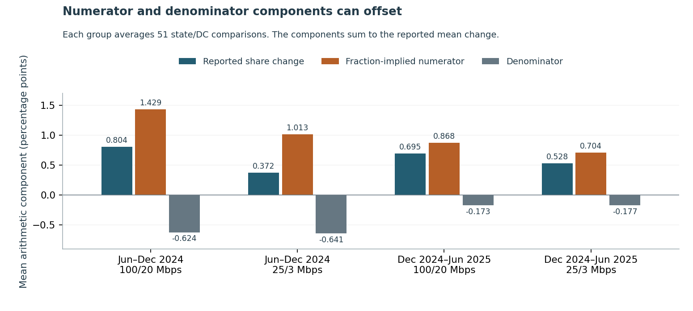

# Check the denominator before claiming broadband coverage gains

A reported availability percentage can move when the map's unit denominator changes. This repository preserves that denominator, separates exact arithmetic components and keeps infeasible counterfactuals unavailable. It helps a planning analyst see what an aggregate coverage chart can support before crediting new service.

**Measured finding:** at the 100/20 Mbps source speed definition, a positive denominator component accompanies **20 of 90** later state transitions with reported share gains. Across all 102 state transitions, that component averages **−0.399 percentage points**, while the reported share change averages **+0.750 points**. Denominator movement works in both directions. These arithmetic components do not identify construction, corrections, adoption or new customer connections.



Read the [six-page study](paper/manuscript.pdf), try the [implementation exercise](exercise/README.md), or run the authored examples:

```powershell
python src/cli.py examples/baseline-authored.json examples/denominator-only-authored.json
python src/cli.py examples/baseline-authored.json examples/numerator-only-authored.json
```

Both invented examples produce a 10-point reported improvement. One has a zero numerator component; the other has a zero denominator component. The guard rejects mismatched identity, unordered dates, invalid numeric strings and unsupported units. It returns unavailable for an infeasible constant-count counterfactual instead of clipping it to 100%. No account, license, key or network is needed for the examples.

## Evidence underneath

- [Protocol](PROTOCOL.md), [public-summary rights](DATA_RIGHTS.md), [capture evidence](ACQUISITION.md), [native label binding](NATIVE_BINDING_NOTE.md) and [source qualification](SOURCE_QUALIFICATION.md). Full FCC archives/documents and individual licensed Fabric records remain excluded.
- Four exact public aggregate ZIPs. A scan of 2,487,660 original records yields the complete fixed 204 state/DC rows, with 408 nine-decimal native shares and 204 integer unit totals. Independent DuckDB/SQL and exact fractions reconcile 2,892 original-row/token conditions. [Native facts](data/summary_rows.csv), [all exclusions](data/coverage.csv) and [source versions/hashes](data/source_receipts.json) remain inspectable.
- [Earlier checkpoint](DEVELOPMENT.md): 102 state/speed comparisons and 408 authored endpoint cases, independently checked in 6,395 conditions. [Thirty-two dependencies](data/dependency_freeze.json) were committed before [204 later comparisons and 816 endpoint cases](results/later), independently checked in 12,023 conditions. No model or threshold is selected or tuned.
- The fixed symmetric numerator/denominator convention, constant-baseline-implied-count counterfactual, exact infeasibility states and declared sensitivity are retained for every state, speed and transition. Fraction-implied served quantities are not exact observed integer served counts. The plus/minus 0.0001 fraction perturbation is authored; it is not a native rounding bound, source-error guarantee or confidence interval.
- Forty-two finite fixtures; three inspected figures with 126 value checks, 312 actual SVG coordinates and nine hashes; 90 source-bound manuscript displays and all six inspected pages. See [local review](REVIEW_RECEIPT.json), [the pull request](https://github.com/S3R3Bii/broadband-map-denominators/pull/2) and [Actions](https://github.com/S3R3Bii/broadband-map-denominators/actions) for release evidence.

## Reproduce the public diagnostic

```powershell
python src/reproduce.py
```

The standard-library numerical replay uses a clean full-history clone and separate regenerated outputs, without source network retrieval or overwriting frozen bytes. Use Python 3.12 and `python -m pip install -r requirements.txt` for optional original-source, figure-regeneration and PDF tools. Original-source reconciliation requires the recorded ZIP snapshots: `python src/verify_originals.py --private-dir <snapshot-folder>`. An older data-as-of date downloaded today may have a different revision; new files are not silently substituted. [LaTeX source](paper/main.tex) and three figure PDFs accompany the paper.

## Use and limits

Preserve geographic/service keys, native fractions, total units and separate data/revision dates. Show signed components and unavailable reasons. To distinguish construction from corrections or changed map membership, obtain authorized matched location histories, provider revision/challenge records and independent delivery evidence. Use adoption and actual-performance data for those separate questions.

This is a two-speed, state-level descriptive audit of the native R-coded terrestrial summary. It does not reconstruct every mixed-use classification rule, individual Fabric record or provider claim. Map units are not people, subscriptions or unique buildings. The specification's All Terrestrial label differs from the CSV's Any Terrestrial; the binding and source exposure are explicit. Retrieved summaries are not original first-publication vintages. Repeated states/speeds share inputs; exact arithmetic does not establish source truth or causality. No trained model, location-level spatial join, Census API analysis, new estimator, deployment, peer review or measured public/financial benefit is established. Independent program manuscript only; separate formal-publication projects remain private.
